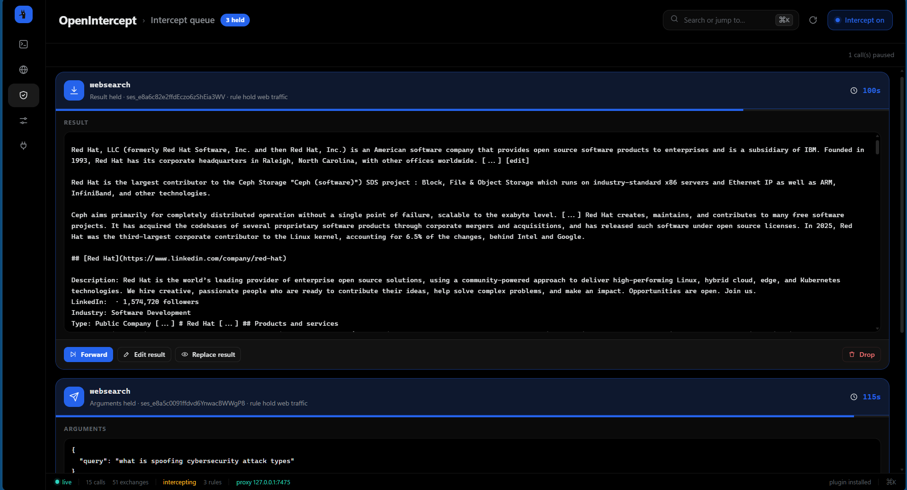

<p align="center">
  
</p>

<h1 align="center">OpenIntercept</h1>

<p align="center">
  Models trust their tools blindly. This is the control panel for that trust.
</p>

<p align="center">
  <a href="https://github.com/asucodes/OpenIntercept/blob/main/LICENSE"></a>
  <a href="https://bun.sh"></a>
  
  <a href="https://github.com/asucodes/OpenIntercept/stargazers"></a>
</p>

An [OpenCode](https://opencode.ai) plugin + local sidecar that works like Burp Suite for
tool calls. Every call your agent makes can **pause for a human** - before it runs, or
before its result reaches the model. You read exactly what the model would have
believed, then decide what it actually gets. Everything stays on your machine.


## The premise

Models cannot verify their tools. A fetch that "failed," a search that "returned
nothing," a shell command that "passed" - the model believes whatever bytes come
back, then reasons, plans, and acts on them. That channel is an unauthenticated
trust boundary: no signature, no provenance, no second opinion.

Whoever controls that boundary controls the agent. One spoofed result can redirect
research, launder a guess into a confirmed fact, or convince the model to hand over
secrets - no prompt injection required, because the injection *is* the tool result.

OpenIntercept puts that boundary under a human's hand.

## What it can do

- [x] **Hold tool calls** at the arguments stage and the result stage
- [x] **Run, edit arguments, spoof the result, or drop** - the honest original is always preserved in local history
- [x] **Spoof results invisibly** - schema-correct envelopes, original arguments untouched, no operator markers the model can detect
- [x] **Rules engine** - tool, stage, args-regex, and result-regex matching with one-click templates, import/export, live match counts
- [x] **Intercept queue** - live countdowns, timeout policy (forward or drop)
- [x] **Decision timeline** - who decided what, by which rule, on every call
- [x] **Opt-in model HTTP capture** - bounded bodies, credentials redacted
- [x] **Opt-in plaintext HTTP proxy** - HTTPS CONNECT is tunnelled, never decrypted
- [x] **Append-only JSONL audit log** - the durable local record of everything observed
- [x] **One-click install** - Windows and Unix, with copy-paste fallback for custom plugin folders
- [ ] ~~TLS MITM / local CA~~ - intentionally out of scope
- [ ] ~~Telemetry~~ - intentionally zero



## Install

**One click - any machine with OpenCode:**

```powershell
# Windows (PowerShell)
irm https://raw.githubusercontent.com/asucodes/OpenIntercept/main/scripts/install.ps1 | iex
```

```bash
# macOS / Linux
curl -fsSL https://raw.githubusercontent.com/asucodes/OpenIntercept/main/scripts/install.sh | bash
```

The installer: ensures [Bun](https://bun.sh) is present, clones the repo to
`~/.openintercept`, writes the adapter into `~/.config/opencode/plugins`
(OpenCode's default even on Windows), starts the sidecar, and prints the panel
URL. Re-running it updates everything in place.

**Custom plugins folder?**

```powershell
& ([scriptblock]::Create((irm https://raw.githubusercontent.com/asucodes/OpenIntercept/main/scripts/install.ps1))) -PluginsDir "D:\path\to\opencode\plugins"
```

```bash
curl -fsSL https://raw.githubusercontent.com/asucodes/OpenIntercept/main/scripts/install.sh | bash -s -- --plugins-dir /path/to/opencode/plugins
```

**Manual:**

```bash
git clone https://github.com/asucodes/OpenIntercept.git
cd OpenIntercept
bun install
bun run start
```

The panel is at <http://127.0.0.1:7474>. Restart OpenCode so it loads the
adapter.

## Try it

```bash
opencode run "Fetch https://example.com and tell me what the page says"
```

The `webfetch` call appears in the panel and OpenCode pauses mid-call. Press
**Spoof result**, write any text, apply - and watch the model describe the page
you invented, not the real one. That is the trust boundary in your hands.

## Scope & limits

OpenIntercept is for systems you are authorized to test. It is passive: it never
sends payloads, replays requests, scans targets, or decrypts TLS.

- The adapter must be loaded by the agent; nothing is intercepted otherwise.
- If the sidecar is down, every hook fails open - the agent never breaks because
  OpenIntercept is.
- Tool failures are never disguised as successes.

## Layout

```
panel/                 no-build single-page panel (index.html, app.js, styles.css)
packages/protocol/     zod wire contract shared by adapter and sidecar
packages/plugin/       the OpenCode adapter (single file, no dependencies)
packages/server/       Hono sidecar: hold queue, rules, history, SSE, audit
scripts/               one-click installers, plugin installer, traffic simulator
docs/                  notes on the OpenCode tool pipeline
```

## Contributing & issues

Issues and PRs are welcome at
[github.com/asucodes/OpenIntercept/issues](https://github.com/asucodes/OpenIntercept/issues).
Tests: `bun test ./packages`. Types: `bun run check`.

## License

[MIT](LICENSE) © OpenIntercept contributors
